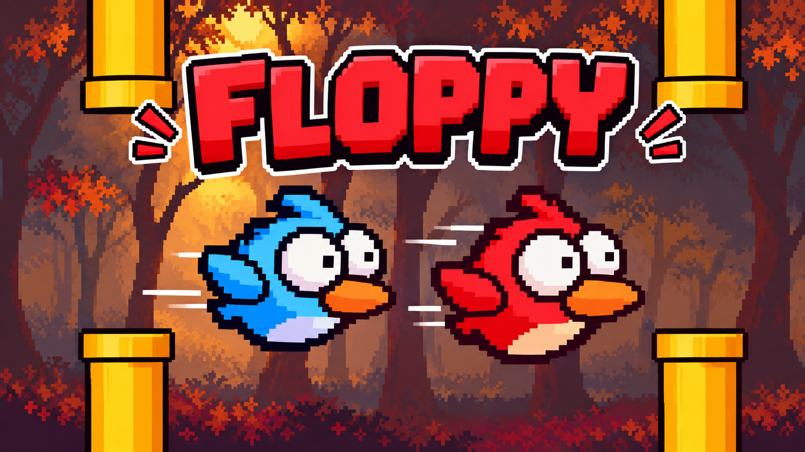

## About the Game
**Floppy - El Pájaro que Vuela: Remaster Edition** is a Flappy Bird-inspired game developed in C++ using the Raylib library.

Control your bird, avoid obstacles and try to achieve the highest score possible!

The game includes single-player and multiplayer modes, allowing players to compete and see who can survive the longest.

## Objective
The main objective is to get the highest score possible by passing through the pipes without colliding with them.

Each successfully passed pipe increases your score by 1 point.

## Controls

| Player | Controls |
|---|---|
| Player 1 | SPACE – Fly upwards |
| Player 2 | UP ARROW – Fly upwards |

## Rules
- Avoid hitting the pipes.
- Do not let your bird touch the ground.
- Each pipe passed gives you 1 point.
- If your bird collides with an obstacle or the ground, you lose.
- The player with the highest score wins!

## Technologies
- **Programming Language:** C++
- **Graphics Library:** Raylib 6.0
- **IDE:** Visual Studio

## How to Run
1. Download or clone the project repository.
2. Open the project solution in Visual Studio.
3. Make sure Raylib is properly configured.
4. Build and run the project.
5. Enjoy the game!

## Credits

**Original Made By:**  
Santino Giuffrida Castillo

**Finished By:**  
Mercedes Ramirez Diaz

---

**Thanks for playing Floppy!**